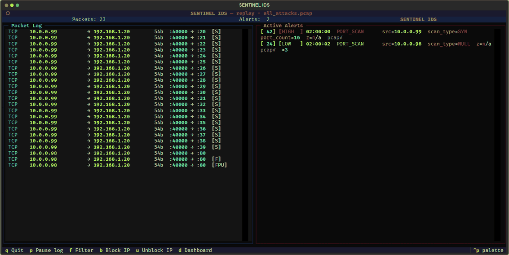

# SENTINEL IDS – Demo Guide

Every scenario below reproduces exactly: the commands, the alerts that appear, and
the one thing worth saying about each. Run everything from the `sentinel/` folder.

---

## 0. Before any demo

```bash
pip install -r requirements.txt -r requirements-dev.txt
python -m pytest                    # green suite first - ~4 seconds
python scripts/make_samples.py      # writes pcap_samples/*.pcap
```

`make_samples.py` builds one capture per attack plus `all_attacks.pcap`. They are
deterministic – fixed timestamps, seeded random sources – and `tests/test_samples.py`
replays every one of them through the detectors, so a green suite means every
scenario here still fires.

Optional extras: the free MaxMind `GeoLite2-City.mmdb` in `data/` (country and city
on public sources), and Wireshark to open the evidence files.

## Pick a mode

| Mode | Needs | Use it when |
|------|-------|-------------|
| Replay – `python main.py --replay <file>` | nothing: no Npcap, no admin | an interview room, a laptop, any time it must work exactly the same |
| Feature demos – `python scripts/demo_*.py` | nothing | showing one Phase 11 feature on its own |
| Live – `python main.py` + `scripts/sim_*.py` | Npcap | proving it on real traffic |

---

## 1. Every attack in one replay

```bash
python main.py --replay pcap_samples/all_attacks.pcap --speed 4
```

The header reads `replay · all_attacks.pcap`. The five scenarios play back to back,
fifteen seconds of packet time apart, so at `--speed 4` the whole run takes about
seventeen seconds. Nine alert episodes land in **Active Alerts**:

| Packet time | Alert | Severity | Source | Score | Evidence |
|-------------|-------|----------|--------|-------|----------|
| +0s  | PORT_SCAN – SYN, 16 ports | HIGH | 10.0.0.99 | 42 | pcap |
| +2s  | PORT_SCAN – NULL, FIN, XMAS `×3` | LOW | 10.0.0.98 | 24 | pcap |
| +16s | ARP_SPOOF – mac_conflict | HIGH | 192.168.1.1 | 63 | pcap |
| +17s | ARP_SPOOF – gratuitous flood | MEDIUM | 192.168.1.200 | 45 | pcap |
| +32s | BRUTE_FORCE – SSH | HIGH | 10.0.0.77 | 35 | pcap |
| +38s | BRUTE_FORCE – HTTP | HIGH | 10.0.0.78 | 35 | pcap |
| +45s | DNS_ANOMALY – long label, high entropy `×2` | HIGH | 10.0.0.88 | 34 | pcap |
| +48s | DNS_ANOMALY – query flood | MEDIUM | 10.0.0.88 | 22 | pcap |
| +65s | SYN_FLOOD – 101 SYNs, 0 ACKs | HIGH | none | 52 | none |

The clock column shows the capture's own time (2026-01-01 00:00 UTC, in your local
time zone), not the wall clock: every window in SENTINEL runs on packet time.



What to point at:

- **The score beside the severity.** Six alerts say HIGH; the score ranks them – an
  ARP spoof at 63 outranks a brute force at 35, because the attack type multiplies
  the evidence.
- **`×3` and `×2`.** The three stealth probes come from one source with one severity,
  so deduplication folds them into a single row with a counter instead of three.
- **The SYN flood has no source and no evidence file.** Its sources are spoofed; the
  detector keys on the target instead, and pressing `b` on it refuses – blocking a
  forged address would punish an innocent host.

Then press `d`: the dashboard opens in the browser (starting its server if needed)
with the same nine episodes, the traffic chart, the attack mix and the top talkers.

## 2. One attack at a time

```bash
python main.py --replay pcap_samples/<name>.pcap
```

| Sample | Expect | Say |
|--------|--------|-----|
| `port_scan` | PORT_SCAN HIGH (10.0.0.99), PORT_SCAN LOW ×3 (10.0.0.98) | More than 15 distinct ports from one source in 5 seconds is a scan; it fires on the 16th. NULL, FIN and XMAS probes have no legitimate use at all, so a single one is enough. |
| `arp_spoof` | ARP_SPOOF HIGH (192.168.1.1), ARP_SPOOF MEDIUM (192.168.1.200) | The detector keeps an IP→MAC table; a second MAC claiming a known IP is the man-in-the-middle signature. Unsolicited replies where sender IP equals target IP are gratuitous ARP – more than three a minute is a flood. |
| `brute_force` | BRUTE_FORCE HIGH twice (10.0.0.77 SSH, 10.0.0.78 HTTP) | Every SSH login attempt is a new TCP connection, so five SYNs to port 22 in 30 seconds is the signal. HTTP is counted by `POST /login` in the payload. |
| `dns_tunnel` | DNS_ANOMALY HIGH ×2, DNS_ANOMALY MEDIUM (all 10.0.0.88) | Exfiltration hides data in the query name: a label over 50 characters, a Base32 label with Shannon entropy over 3.5, or 50 queries for one name in a minute. |
| `syn_flood` | SYN_FLOOD HIGH (no source) | SYNs that never finish the handshake: the SYN-to-ACK ratio against one target passes 50. The flood lasts six seconds on purpose – the detector judges once per 5-second window. |

## 3. Follow an alert to its evidence

Every episode with a known source writes the source's last 30 seconds of traffic to
`captures/` at the moment it opens: the terminal marks it `pcap✓`, the dashboard
names the file.

```bash
tshark -r captures/<file>.pcap          # or open it in Wireshark
```

From the port-scan replay the file holds exactly the sixteen SYNs that proved the
scan – nothing from any other host. **Say:** an alert is always late, since a scan
is only called once enough ports have gone by; the packet ring is what lets the
alert look backwards at the packets that tripped it.

## 4. The Phase 11 features on their own

No capture at all – each script feeds packets through the real pipeline into the TUI.

| Script | What happens |
|--------|--------------|
| `python scripts/demo_scoring.py` | An ARP spoof repeats, so its score climbs from amber into red; then the source floods, its baseline deviation saturates and the score pins at 100. |
| `python scripts/demo_baseline.py` | A host learns a steady packet rate, then bursts: BASELINE_ANOMALY on a z-score past its *own* history. |
| `python scripts/demo_geoip.py` | Five sources, five answers: country and city, a Tor exit, anycast with no country, a private address that is not a place. Needs the GeoLite2 file. |
| `python scripts/demo_pcap.py` | Three sources, three evidence outcomes; the files written are listed on exit. |

## 5. Live traffic

Terminal 1, then each simulation from terminal 2:

```bash
python main.py
python scripts/sim_port_scan.py      # PORT_SCAN HIGH from 10.0.0.99
python scripts/sim_arp_spoof.py      # ARP_SPOOF HIGH and MEDIUM
python scripts/sim_brute_force.py    # BRUTE_FORCE HIGH: SSH, then HTTP
python scripts/sim_dns_tunnel.py     # DNS_ANOMALY HIGH, then MEDIUM
python scripts/sim_syn_flood.py      # SYN_FLOOD HIGH, then MEDIUM
```

Npcap must be installed. Whether capturing and sending need an administrator
terminal depends on the "restrict to administrators" choice made when Npcap was
installed.

Things live traffic adds:

- The simulated attackers are spoofed (10.0.0.x), so the router answers them with
  ARP *who-has 10.0.0.99?* – those requests land in the port scan's evidence file,
  because the ring keeps traffic **to** the attacker as well as from it.
- A fast scan of 24 ports at one host can also trip SYN_FLOOD MEDIUM on that host:
  24 SYNs and no ACKs is half-open traffic either way. Two detectors, two views of
  the same packets.
- The real gateway's own ARP replies interleave with the simulated ones, so the
  mac_conflict alert repeats – the dedup counter shows how often.
- Real traffic brings real false positives. A CDN or telemetry hostname with a
  random-looking label can trip the entropy check on its own – seen on the
  development machine from its own IPv6 address. DNS anomalies carry a 0.9 weight,
  so a lone entropy hit scores 32 – green, under the medium band that starts at 40.
- Run the simulations only on a network you own. They send low-volume spoofed
  packets; the ARP one sends unicast to a MAC no device owns, so it cannot rewrite
  anyone's ARP cache.

## 6. Block and unblock

Blocking needs an administrator terminal, since it adds a Windows Firewall rule.

```bash
python main.py --replay pcap_samples/port_scan.pcap
```

Press `b`: the source of the most recent alert gets a rule named
`SENTINEL_block_<ip>`; check it with
`netsh advfirewall firewall show rule name=SENTINEL_block_10.0.0.98`. Press `u` to
lift it. The dashboard's **Blocked IPs** panel follows within five seconds.

What refuses, and why:

- **No admin:** *Firewall rejected block (run as admin?)* – and nothing is written to
  the database, since the block is recorded only after the firewall accepts it.
- **Whitelisted IP** (`response.whitelist`, e.g. the gateway): refused, because
  blocking it would cut the machine off the network.
- **SYN flood:** *No source IP to block* – the sources are forged.

---

## Troubleshooting

| Symptom | Cause |
|---------|-------|
| `no such capture file` | Run `python scripts/make_samples.py` first. |
| The dashboard shows nothing | It reads `sentinel.db` in the current folder – start both from `sentinel/`. |
| Countries show as two letters | Windows has no flag-emoji font; the browser prints the letters. |
| `d` reports the dashboard did not come up | Something else holds port 8888, or the server failed to start – run `python -m ui.web` by hand to see why. |
